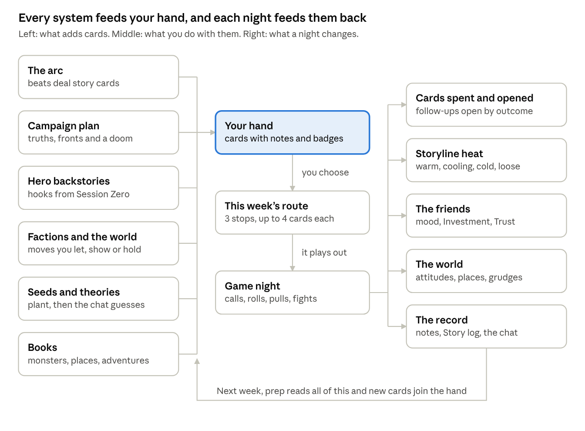

# Behind the Screen: game overview for collaborators

October 27, 2026. Exported from the project's Claude Doc; this copy is for anyone working in the code. If it and the code disagree, the code is what ships.

> **Which version this describes (updated October 29).** The current build (`main`) is the October 20 version plus a prototype notice on launch. Its setup and prep are full-page screens: the campaign planner, Session Zero, the backstories, and the prep board (the valley map, three scenes with their slots, "Previously on" in the left column, a drawer for seeds and evenings off, a column for the group chat and messages, and the notebook's "This week" page for the world's moves, who the session is for and who shows up). Faces on choices and cards always show who'd love each option. This overview was written for the October 26 step-by-step rework (one decision at a time, Chill mode, longer speech bubbles), which was set aside and lives on the `step-by-step` branch. Where they differ, the step-by-step and Chill mode details below don't apply to the current build; the systems, the story, game night and the findings mostly do.

## What the game is

Behind the Screen is a cozy single-player game where you are the Dungeon Master for four simulated friends who meet every Thursday to play a fantasy tabletop game. You don't play a hero; you run the table. You plan each session, make the calls when game night needs you, read how your friends are feeling, and keep a story going that they care about week after week.

The fantasy is being a good DM: the friend who makes Thursday the best night of everyone's week. The game is a social simulation wrapped around a story engine and a real rules engine (SRD 5.2.1, the free D&D 5e rules). Its tone is warm and low-pressure: there is no game over, nobody leaves without warning, and a bad night is a story, not a failure.

- **Engine:** Defold 1.13.2, Lua. Every model and rule is engine-free Lua, so the whole campaign can be simulated headlessly.
- **Scope today:** a vertical slice of Session Zero plus the first four sessions of a 20-session campaign, *The Silent Bells*, with "Keep playing" beyond it.
- **Direction:** fewer, clearer decisions with more character. The current build opens on a short prototype notice and uses full-page screens for setup and prep, with faces showing who'd like each option. An October 26 rework that asked one decision at a time (with Chill mode hiding the faces) was set aside and is on the `step-by-step` branch.

## The loop

A campaign is set up once, then every week runs prep, game night and a report. In the current build, setup is the campaign planner, then Session Zero, then the backstories, and prep is one board (see the note at the top). The step counts below are from the set-aside step-by-step version; the decisions are the same.

1. **Setting up (once).** About 20 steps (two players) to 29 (all four):
   - **The campaign:** who's at the table (two to start, the others joining in sessions 2 and 3, or all four), the campaign style (frontier town, seafaring, urban, dungeon, wilderness), three truths about the world, a second threat ("front") beside the main villain, and your dice.
   - **Session Zero:** the tone, each player's ask (a line, a veil or a promise), and table rules (X-card, which rolls are in the open, how rules calls work, session length, what happens when a hero dies).
   - **Backstories:** each player pitches their hero's past. You ask questions from a shared budget of six, answer the idea they bring, and choose which piece of their past turns up first in your hand.
2. **Prep (weekly).** About 19 steps in session 1 and 30 to 34 from session 2, in four sections:
   - **This week:** where the story stands (with each hero's thoughts about last session), the group chat, how everyone's doing (coffee with a player costs 2 hours), each faction's move off screen (let it happen, bring it on screen as a card, or hold it), levelling up, who the session is for, who shows up, and an evening off that draws new cards.
   - **The route:** three stops on the valley map, or an open scene where the players choose.
   - **Each stop:** a kind of scene (combat, social, exploration, puzzle, mystery, downtime, set piece), then four card slots (who's there, what they're after, what gets in the way, what they can win), each picked from your hand or left to improvise, and a fight builder for combat stops.
   - **Before the night:** plant a seed (a mystery that pays off later), then a summary.
   - The budget is about 12 prep hours a week, so some slots are always improvised.
3. **What tonight can change.** A board of each stop's stakes: the clue it can turn up, what a win or a loss puts in next week's hand, which villain plan it can hold back.
4. **Game night.** It plays itself on a 3D tabletop: scenery drops in, paper minis move, fights run on the rules engine, and the friends talk, cheer, yawn or check their phones. You make 8 to 15 calls on cards that slide in, then press on. A night runs about 15 minutes.
5. **The session report.** A recap you can edit (pin a beat, cut one, retitle), how each player felt (least happy first), a verdict, what was earned (level-ups, dice, gifts) and a wrap-up of what moved.
6. **Between sessions.** The group chat, private messages, table conflicts brewing, players who drift and come back, someone new joining a small table. Then the next week's prep.

## The table: four friends you have to read

The players are the real subject of the game. Each is a person with tastes, a week outside the game, and opinions about you as a DM. Their archetypes come from Robin Laws' player types; the primary counts double, the secondary once.

| Player | Hero | Archetypes | Wants | Pain point |
| --- | --- | --- | --- | --- |
| Mara | Thessaly, Wizard | Storyteller, Explorer | Mysteries, reveals, her sister Ilsa's story taken seriously | Long fights; jokes in her serious moments |
| Dev | Brannoc, Fighter | Butt-kicker, Power gamer | Fights, loot, Kessrick (the warlord who burned his village) | Long talky scenes; rule-of-cool rulings against him |
| Jess | Pip, Rogue | Method actor, Instigator | Talking to NPCs in voice, chaos, Pip's debt to the Velvet Hand | Having her scenes cut short |
| Sam | Oswin, Cleric | Casual, Tactician | Friends, snacks, a fair clever fight, consistent rules | Being put on the spot |

**What the simulation tracks for each player:**

- **Session meters** (spotlight, challenge, story, social, reward) move beat by beat on game night. Weighted by archetype, they make **Fun**; boredom builds when a scene isn't for them. A visible **tell** shows how they're doing ("grinning", "eyeing their phone").
- **Long-term bars** settle after each night: **Commitment** (will they keep coming), **Investment** (do they care about the story), **Trust** (do they trust you) and **Suspicion** (do they think you cook rolls).
- **Mood** is rolled weekly (fine, tired, celebrating, stressed, chatty, distracted) and changes how they take the night. It's hidden until you have coffee with them.
- **Goodwill** fills on good nights; a full heart means they bring you a gift (a keepsake that stays on your side of the table).
- **Rapport** between each pair of players can sour into friction you defuse or let slide.

**Reading them is a skill, and it grows.** **Empathy** (five levels, Clueless to Reads minds) rises with every game night and one-on-one. It sets how precisely bars show, whether they update live, and whether you get early warnings. Bars are fills and icons, never numbers, and Suspicion is always a blurred band. With Chill mode off (the default), choices show no "who'd like it" faces: you read the table from their words, their thoughts and their posture.

**The social layer.** Three table conflicts can build from what happens at the table: Jess hogging the spotlight, Dev and Sam fighting over rules calls, and Mara's serious story against Jess's jokes. Each has several fixes (a message, a group post, enough good calls at the table, a planned week). A player whose Commitment falls below 25 says so in the group chat. After two weeks of that, and still below 20, they take a 3 to 5 week break, then come back with a fresh start. Nobody leaves without warning, and there's no hard fail.

## How stories work

The story is not a script the game plays at you; it is a deck of cards, several storylines running at once, and a world that moves on its own. The DM decides which threads get scenes each week, and how each scene goes decides what is dealt next. A fixed arc gives it a spine.

**The spine: the arc.** *The Silent Bells* is a 20-session campaign. The slice is its first act: Session Zero plus four beats ("Strangers at the Kettle", "The road out", "Old debts", "Up the bell tower").

- **Beats:** each beat has an objective ("Find out why Millbrook's bells went silent"), a hint for the DM, and three or four story cards dealt into your hand. Playing them moves the story; ignoring them is allowed. Session 4 turns the act: end it high and the table can't wait for session 5.
- **Clues:** story cards reveal clues when they play, and clues unlock later beats.
- **Big questions:** each has at least three roads to its answer, so a missed clue doesn't dead-end the campaign.

**The engine: a deck of cards with memory.** Every scene is a place plus up to four cards: who's there, what they're after, what gets in the way, what they can win.

- **Follow-ups:** each card can open others on a win or on a loss.
- **Memory:** places and people recur and remember what happened to them; goals, complications, rewards and clues are spent once played.
- **What feeds the deck:** the campaign plan adds cards (truths, fronts), and so do seeds, factions, books, the world's moves and the DM's own improvising.

**The storylines run in parallel.** Each storyline is warm, cooling, cold, loose (dropped: the table noticed), or resolved. Scenes move the storylines their cards belong to.

| Storyline system | What it is | What moves it | What it costs or pays |
| --- | --- | --- | --- |
| The main story | The arc's mystery (the bells) | Story cards on the route | Clues, beats, the act turning |
| Hero backstories | One per player, written at Session Zero (Ilsa, Kessrick, the Velvet Hand debt, Oswin's relic) | Their cards; the session's spotlight; two "featured" heroes get theirs sooner | A dropped one costs that player Investment and Trust each week until it returns |
| Fronts and factions | The main villain (Kessrick's warband), a second threat chosen at setup, and the town's factions | Each faction proposes a move every week: you let it happen (a fortune roll behind the screen), bring it on screen as a card, or hold it | Unchecked fronts advance portents toward a "doom"; results land in the deck, people's attitudes, places and the chat |
| Seeds | Small mysteries you plant (1 hour) | Planting, then placing the payoff card within 3 weeks | A big moment and a nudge to a subclass; left too long it goes stale and the theorists notice |
| Theories | The group chat guesses at your mysteries | You encourage, deflect, shoot down, or "make it true" | A theory made true proves that player right at the payoff |
| Pulls | Each player's hidden pull: their own story, a thread going quiet, a theory, a kind of place | At most once a stop someone pulls the table; you follow, weave it in, park it, or steer back | Parked pulls become owed threads that glow on the map and sour if unpaid; steering back twice a night reads as railroading |
| Villains | A ledger of grudges per villain | Fights, escapes, humiliations, jokes at their expense | Monologues built from that ledger; villains who get away come back with a grudge |
| Improvised canon | What you make up when a slot was empty | Improv hands on game night | It becomes canon; running jokes recur until they go stale |

**Juggling is the skill.** Too many storylines in one night and the table loses the thread. Two scenes on the same one builds momentum ("it all starts connecting"). A loose end hurts the players who cared, and picking it up again surprises them and wins back what was lost.

**Other things that feed the story:**

- **Campaign style:** the deck leans to the style's cards. A gateway card can change course mid-campaign, as a nudge if the players take it up or a force if a story event plays it.
- **Books:** sourcebooks arrive on set weeks. Reading one pulls in monsters, magic items, places, hooks and whole published adventures.
- **Death:** handled the way Session Zero agreed, with a goodbye, a new character, or a way back at a cost (a quest).
- **Keepsakes, handouts, snapshots and the people's ledger** keep the world remembering the party.

## How the DM learns where the story is

The player is the DM, so the game has to keep a lot of moving story in their head without turning into a spreadsheet. The rule is that the friends carry as much of it as possible: what they remember, theorize, want and feel is shown in their own words. The notebook holds the full record for anyone who wants to dig.

**During prep (the step-by-step flow):**

- **The story so far** opens every week. It shows where the story stands, each past scene in a line (click one to see that storyline's log), what the party is out to do, what's new since last week, and "what only you know" (secrets the players haven't found yet).
- **Recap in their heads:** each hero thinks about the moment from last session they'd remember most, and how their own story stands (warm, going cold, dropped, resolved). This doubles as a recap for the human playing.
- **The group chat:** what everyone's posting, theories to answer or make true, and private messages beside them.
- **How's everyone doing:** notes and warnings per friend, their mood, Goodwill and long-term bars.
- **The world:** each faction's move this week, one at a time, with what happens if you let it, show it or hold it.
- **The valley map:** the stops in play, threads drawn between places, and owed threads glowing. Every place in play is also listed under the map.
- **The hand:** cards carry badges and short notes, such as "This week's story", "suits the bell tower" or "odd here?" when a card doesn't fit the place.
- **Ready for Thursday?:** each stop at a glance, then "worth knowing": how long the night will run, pacing, storylines too many or too cold, Session Zero flags, and anything still open. The friends think aloud about Thursday.
- **Chill mode** (off by default): green and red faces on choices and dots on cards show who'd love what. Without it, the DM reads the table from words and posture.

**During game night:**

- An opening cinematic and "Last session… / here we are today" slides recap the story in the players' framing.
- Each scene's read-aloud caption is the DM's text, and the party's reactions play out in speech bubbles.
- A "New in your notes" toast appears when something enters the record: a person met, a place found, a clue, a grudge.
- Cards that slide across the screen say what's at stake. Owed threads and hidden pulls surface as players pulling the table.
- A recap card closes the night, followed by the report: what landed, who loved what, what moved.

**Any time:**

- **The Story log (S):** every storyline, with keywords and a one-glance status.
- **The notebook (N),** in tabs:
  - session, campaign, people, factions and places;
  - a web of who knows whom;
  - the story log, the story so far and the session log;
  - the party sheet.
- **The lore screen,** "What tonight can change": the secrets and clues tonight's cards could reveal.

## How the systems overlap

Nearly every system does one of three things: it adds cards to your hand, it changes how the friends feel, or it writes to the record. Game night is where they all meet, and what happens there is what next week's prep reads.

**One card touches several systems at once.** A card can belong to a storyline (it moves that storyline's heat), to a hero's backstory (that player's Investment), to a faction (its attitude to the party) and to a place (which remembers). Each friend also likes some kinds of card more than others. So placing one card moves all of these together, which is why filling a slot is the core decision of prep.

**Other places they meet:**

- **The spotlight:** who the session is for decides whose backstory cards come forward and whose pulls fire.
- **Session Zero:** what the table agreed (the X-card, how dice are rolled, death, session length) reaches into every game night. The session length sets the table clock, and crossing a line the table drew costs Trust.
- **The world moves on its own:** a faction move you let happen resolves behind the screen and shows up as changed attitudes, places and chat. A move you bring on screen becomes a card in your hand instead.
- **What the story needs against what the friends want:** the arc's cards aren't always what tonight's table wants. The DM balances moving the story with keeping each friend engaged, and a player pulling the table mid-scene is where that tension shows.
- **The rules feed the story:** a fight's outcome, a big roll made in the open, or a hero's death all write to the record and open or close cards.

**Worked example 1: a backstory hook.**

1. At Session Zero, Mara pitches Thessaly, whose sister Ilsa vanished from Millbrook's scriptorium. You choose what turns up first: Corin, Ilsa's assistant, who flinches at her name.
2. Corin's card waits at the front of week 1's hand, marked as part of Mara's story. His secret (he kept Ilsa's last letter from Thessaly) is yours to know until the table finds it.
3. You place him at the Kettle as "who's there". On game night he offers Ilsa's notes if Thessaly promises to bring her home, and Mara leans in.
4. A win opens Ilsa's journal and her room as new cards. A loss opens "Corin has vanished" and the man in the grey coat. Either way Corin enters the notebook, Mara's storyline gets a line in the Story log, and it is warm.
5. When Corin comes back he remembers: "Corin has started leaving the door unlocked for Thessaly." Next prep, Thessaly's thought in the recap step is about him.
6. Leave her story out and it cools, goes cold, and is finally dropped. Mara's Investment and Trust then slip every week until it returns, and picking it up again surprises her and wins back what was lost.

**Worked example 2: a seed the table solves.**

1. In prep you plant "The retired captain" (1 hour). On game night an old soldier drinks alone at the Kettle, a folded banner on her table; she won't say whose it was.
2. From the next week her payoff card (Captain Holt, retired) is in your hand for three weeks, and the chat starts theorizing about "the old soldier at the Kettle".
3. In the chat step you can encourage a theory, deflect it, shoot it down, or make it true. Making it true gives the theorist +3 Investment at once and proves them right when the payoff plays. A theory that contradicts a clue already found can't be made true.
4. Place Holt and the seed pays off in a big moment. It also nudges Dev toward the Banner Captain subclass when Brannoc reaches level 3: the one story that might pull him away from Champion.
5. Leave it past three weeks and it goes stale, and the theorists notice.

## The rules underneath, and the fights

The dice and the fights run on a real D&D rules engine, so the table plays by the same rules a real one does. The player never has to run it by hand: the engine plays the rules, and the DM makes the calls a DM makes.

**The engine.** It uses SRD 5.2.1 (the free D&D 2024 rules), with characters at levels 2 to 4, twelve subclasses and twelve SRD monsters with full stat blocks. A check is d20 plus the character's skill against a DC ("Pip, roll Sleight of Hand. DC 10."). Whoever is good at the skill and short on spotlight steps up. Character sheets show the engine's own numbers: Armor Class, hit points, saves, all 18 skills, attacks, spells and features.

**Big rolls are the DM's oldest dilemma.**

- **In the open:** the table sees the die and the DC, and trusts the result.
- **Behind the screen:** the DC stays hidden, so you can cook it, nudging it to save a hero or keep a story going.
- **Suspicion** grows with cooking. It is always shown as a blurred band, and cook too often and someone asks to see the dice.
- **However it lands,** you choose how it plays: generous, straight or with a cost.
- **Failing is fun when it's handled well:** a missed big roll deals three "fail forward" cards, and natural 1s go to dice jail.
- **Some checks are secret** (noticing an ambush, reading a liar): you roll those behind the screen.

**Fights are built in prep.**

- **The fight step:** a combat stop has a fight step. You pick monsters and see the XP against the SRD's Low, Moderate and High budgets, with the engine's forecast of how it will go.
- **The matchup:** notes on how that lineup plays against these four heroes, who it's good against and who gets to shine.
- **The map:** set pieces carry their SRD rules. Tables are Half Cover, pillars Three-Quarters, walls Total Cover; rubble and webs are Difficult Terrain; doors open, lock and get forced; the map can be lit Bright, Dim or Dark. A map is saved with its place and becomes that place from then on.
- **On game night:** minis walk square by square, take hits and drop. Fights bring their own decision cards: a hidden roll that would drop a hero, their last death save, a boss who wants to talk, a fight that drags on.

**Taking over.** Once a night you can speak as a key person (warm, guarded or lying, against the table's Insight), and once a night you can run the boss's turn. Each stands in for a decision card.

**Rests and death.** Short and long rests follow the SRD. Death follows what Session Zero agreed:

- the last death save plays as a decision;
- the fallen get a goodbye, or a scar, or a quest to bring them back;
- the player makes a new character;
- a shelf keeps the fallen.

## Progression

Progress happens on four tracks: the party grows, the DM gets better at reading people, the friendships deepen, and the world fills up with things the table made together. None of them is a skill tree; each comes out of playing.

| Track | What grows | How |
| --- | --- | --- |
| The party | Levels 2 to 4 | After two nights at a level the report (and a prep step) offers the level-up; after four the table starts asking. At level 3 each player picks their own subclass for their own reasons (who they are, what their nights were like, a seed that stuck with them), and the DM gets no say. At level 4 everyone takes an Ability Score Improvement. |
| The DM | Empathy, 1 to 5 | Every game night and every one-on-one adds to it. Higher Empathy shows the friends' bars more finely and sooner: from rough quarter fills a week late (Clueless) to trend arrows, early warnings of someone drifting away, and finally precise fills (Reads minds). Suspicion stays a blurred band at every level. |
| The friendships | Commitment, Investment, Trust, Goodwill | Commitment follows recent fun. Investment follows their own story, and Trust follows fair calls and kept promises. A good night fills a friend's Goodwill heart; when it's full, they bring you a keepsake as they pack up (a dice tower shaped like the Kettle, a mug, a candle…). It stays on your side of the table from then on, and they notice when you put it to use. You can give dice too. |
| The world | Places, people, canon | Places you've built maps for become those places for good. People remember the party, villains who escape come back with grudges, improvised details become canon, running jokes come back, and the notebook fills. Sourcebooks arrive on set weeks and open new monsters, items, places and adventures. |

**The campaign's own progress.** Each week deals one beat of the arc, and the fourth session turns the first act. After it comes a scrapbook: each player's four nights, their level and subclass, their best line, and whether they're coming back. A short survey follows, then "Keep playing" carries on past the slice.

**Losing ground is part of it.**

- **Breaks:** a friend whose Commitment sinks says so in the chat; if it stays low, they take a break for a few weeks. A check-in during prep brings them back sooner, and nobody leaves without warning.
- **Conflicts:** table conflicts (one player hogging the spotlight, rules arguments, a clash of tone) cost the people in them every week until settled, and each can be settled at least two ways.

## Why it could be fun

The fantasy is the best part of being a DM without the parts that make people quit: no blank page, no rules to memorize, no scheduling, no one actually let down. What's left is the craft and the warmth.

- **Reading people is the game.** The core skill isn't optimization, it's noticing: Dev folding his arms, Sam reaching for a phone, Mara going quiet when her sister's name comes up. Chill mode is off by default for this reason. The satisfaction is the same as at a real table: guessing what someone will love, giving it to them, and watching them light up.
- **Prep is a puzzle with a payoff.** Twelve hours, three stops, a hand that never covers everything. Every slot is a small bet about four people at once, and game night shows whether it paid off. The gap between planning and watching it play is where the tension lives.
- **The story is yours and theirs.** Nothing is pre-written beyond the spine. What you improvise becomes canon, a theory from the chat can become the truth, villains remember, and the record afterwards reads like a campaign your group actually played.
- **Small calls carry weight.** Whether to cook a roll, whether to follow a player's tangent, whether to cut the joke in Mara's serious scene. These are real DM dilemmas, and the game lets the consequences play out rather than scoring them right or wrong.
- **It's cozy.** A warm room, snacks, dice, friends who mostly like each other. Failure is soft: a bad night means someone's a bit less keen, not a game over, and there's always next week to make it up.
- **Things build up.** Keepsakes accumulate on your side of the table, the map fills with places that are yours, the notebook gets thick, and the friends' stories go somewhere. The pleasure of a long campaign, in short sessions.
- **It teaches the real thing.** Session Zero, safety tools, spotlight balance, fail forward, fronts and clocks are all real DM techniques. Someone who plays this should be a better DM at a real table.

**Who it's for:** people who love D&D stories but don't DM (or are scared to), DMs who enjoy prep and want it without the scheduling, and fans of cozy management and character games.

## Where it stands, and what's still open

**Built.** The vertical slice plays end to end in a Windows build:

- title, then campaign setup (Session Zero and backstories);
- four weeks of prep, game night and report;
- the scrapbook and survey, then "Keep playing".

It is made in Defold 1.13.2 with Lua. The rules, the friends and the story are engine-free Lua with their own tests, and simulated DMs run whole campaigns headless to check balance. The latest pass (October 26) made setup and prep step by step, turned Chill mode off by default, and made game-night speech last longer.

**What simulated playtests found (October 27).** Three AI personas played the real game: a newcomer, a veteran DM and a story lover. Headless simulations also ran 40 slices for each style of DM.

|  | Careful DM | Plans only for fun | Careless DM |
| --- | --- | --- | --- |
| Act 1 lands | 100% | 100% | 78% |
| Coming back (1 to 5) | 4.0 | 4.0 | 3.5 |

A game night runs about 17 minutes (median).

- **What works:**
  - the backstory questions, with a shared budget that teaches you to go easy on the shy player;
  - fronts with portents;
  - the valley map with owed threads glowing;
  - the fight builder, with correct SRD budgets and sharp matchup notes;
  - player pulls, the boss's turn and speaking as an NPC;
  - cooking dice that the table notices;
  - the game-night log, which reads like a real session;
  - reading the table from posture without Chill mode.
- **The weakest link is the story played back to the DM.**
  - Prep's "recap in their heads" repeats stale lines that contradict what happened ("Kessrick's trail is going cold" after the party found it).
  - The biggest moments, such as a hero dying and being brought back, are missing from recaps.
  - The report sometimes gives one hero's backstory to another.
- **Card fit is opaque.**
  - A friend's thought can recommend a card that can't go at that place.
  - Some sea-flavoured cards "suit" an inland inn.
  - The chosen campaign style changes the map more than the story's text.
- **Prep turns into a chore by week 2.**
  - It runs 28 to 34 steps, and the step count grows as you go.
  - There are five faction screens, most with a single option.
  - Once prep time runs out, every empty slot still needs a click.
  - The warning that next week hangs on a clue arrives only after the hours are spent.
- **Consequences are soft:** careless prep still lands the act most of the time, and the first session is hard to fail.

**Open design questions:**

1. How much should the friends spell out? Posture and words alone are more like a real table, but newcomers may need more help.
2. How far should the campaign style reach? It could reskin the arc's own text, or keep a fixed spine.
3. How short can prep get without losing the bets? Options include merging faction moves into one board, auto-improvising once time runs out, and skipping empty steps.
4. How much should a bad week hurt? A careless DM should feel it within the slice.
5. How does it scale past the slice? Twenty sessions need more beats, more books and longer arcs for each friend.

## Glossary

| Term | Meaning |
| --- | --- |
| Act, beat | The arc is divided into acts; each session deals one beat (a title, an objective, three or four story cards). The slice is Act 1. |
| Big roll | A d20 roll that pauses for the DM: in the open or behind the screen, then generous, straight or with a cost. |
| Chill mode | An option, off by default, that shows green and red faces for who'd love each choice. |
| Coffee | A one-on-one with a friend during prep (2 hours). It tells you how their week went and what they really want. |
| Commitment | How likely a friend is to keep coming. It follows recent fun; low for too long, they take a break. |
| Cooking | Moving a hidden DC to change how a roll lands. It raises Suspicion. |
| Decision card | A moment on game night that needs the DM. There are six kinds: story, combat, rules, behind the screen, pacing, table. |
| Empathy | The DM's skill at reading the table, 1 to 5. It decides how precisely you see the friends' bars. |
| Evening off | Up to two prep hours spent on a book, a film or a walk. Each draws cards you wouldn't otherwise get. |
| Featured hero | One of the two heroes chosen at setup whose stories come first. Later, "who the session is for" picks the week's spotlight. |
| Front, portent, doom | A threat that advances on its own: steps (portents) toward an outcome (doom) if nobody stops it. |
| Goodwill, keepsake | A friend's heart, filled by good nights. When it's full they bring a gift that stays on your side of the table. |
| Hand | This week's cards, dealt from the deck. Each has a kind (who's there, goal, complication, reward), a prep cost, and notes on where it fits. |
| Improv hand | One to three cards picked live on game night for an empty slot, or when the party wanders off. |
| Investment | How much a friend cares about the story, especially their own hero's. |
| Loose end | A storyline the table noticed you dropped. It costs Investment and Trust each week until picked up. |
| Lore screen | "What tonight can change": the secrets and clues tonight's cards could reveal, shown before game night. |
| Pull | A friend steering the table toward their own interest mid-scene. You follow it, weave it in, park it (it becomes owed) or steer back. |
| Owed thread | A parked pull or a promise to a friend. It glows on the map until it's paid. |
| Route, stop, slot | The week's plan: up to three stops (places) on the valley map, each with up to four slots. |
| Seed, payoff, theory | A planted mystery; the card that pays it off within three weeks; the chat's guess about it, which you can make true. |
| Session Zero | The first meeting: tone, lines and veils, table rules, backstories. Its agreements apply all campaign. |
| Storyline, heat | A thread of the story (the bells, a backstory, a faction). Its heat is warm, cooling, cold, loose or resolved. |
| Story log | The S key: every storyline, its status and its history. |
| Suspicion | How much the table suspects you're cooking the dice. It is always a blurred band. |
| Taking over | Once a night, speaking as a key person or running the boss's turn yourself. |
| Trust | How much a friend trusts you to be fair: kept promises, fair calls, no railroading. |
| Truths | Three facts about the world chosen at setup. They add cards and flavour. |
